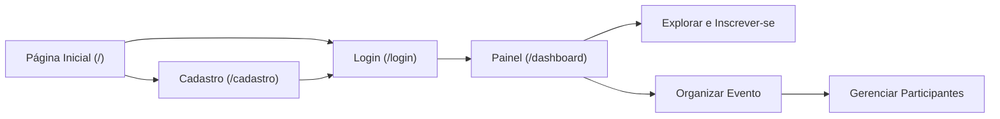

# Visão Geral do Sistema

Bem-vindo à **Wiki Oficial do Norte Eventos** — a central única de documentação pensada tanto para quem usa a plataforma no dia a dia quanto para programadores, professores e mantenedores técnicos.

> [!TIP]
> Use a barra de busca no topo (ou pressione `Ctrl + K`) para encontrar rapidamente qualquer funcionalidade, endpoint da API ou comando Docker.

---

## O que é o Norte Eventos?

O **Norte Eventos** é uma plataforma web para **divulgação, organização e gestão de inscrições de eventos locais** na Região Norte do Brasil (eventos corporativos, sociais, culturais, acadêmicos e institucionais).

O projeto foi desenvolvido na disciplina de **Práticas de Programação (IFAC)** sob a orientação do professor **Álvaro**, utilizando arquitetura **MVC** em **Node.js + Express + MySQL**, empacotado com **Docker Compose** e interface construída em **Tailwind CSS v4**.

---

## Como navegar nesta Wiki

Escolha a trilha conforme o seu objetivo:

| Perfil | O que você encontra | Por onde começar |
|---|---|---|
| **Participante (Usuário)** | Criar conta, buscar eventos, fazer/cancelar inscrições e gerenciar perfil | [Cadastro e Login](/wiki/usuario/primeiros-passos) |
| **Organizador** | Publicar eventos, subir capas personalizadas e gerenciar lista de inscritos | [Criar e Editar Eventos](/wiki/organizador/criar-e-editar-eventos) |
| **Desenvolvedor** | Arquitetura MVC, Docker, MySQL, API REST, segurança e acessibilidade | [Arquitetura MVC e Pastas](/wiki/dev/arquitetura-e-pastas) |
| **Resolução de erros** | Respostas rápidas para problemas de login, uploads, portas e banco | [Perguntas Frequentes (FAQ)](/wiki/faq) |

---

## Principais Funcionalidades

- **Landing Page Editorial (`/`):** apresenta as categorias de eventos, cobertura dos 7 estados da Região Norte e acesso rápido ao painel.
- **Autenticação Segura (`/cadastro` e `/login`):** senhas criptografadas com `bcrypt` e sessão protegida por token **JWT** em cookie `HttpOnly`.
- **Painel de Controle (`/dashboard`):**
  - **Explorar Eventos:** vitrine com busca em tempo real, filtros por categoria e inscrição em um clique.
  - **Dashboard / Visão Geral:** métricas consolidadas de eventos criados e total de participantes.
  - **Meus Eventos:** listagem, edição, exclusão e gestão completa de participantes.
  - **Notificações:** avisos automáticos sobre novas inscrições e alterações em eventos.
  - **Configurações do Perfil:** atualização de nome, e-mail, foto de perfil, senha e exclusão de conta.
- **Execução Padronizada com Docker:** ambiente pronto com um único comando (`docker compose up -d --build`).

---

## Fluxo Geral de Uso

---

## Equipe do Projeto

- **Ana Culqui**
- **Estevão Emanuel**
- **Izabel Lima**
- **Mariana Melo**
- **Williane Gadelha**
