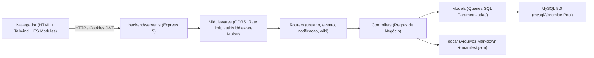

# Arquitetura MVC e Estrutura de Pastas

O **Norte Eventos** foi projetado seguindo o padrão **MVC (Model-View-Controller)** com separação clara entre servidor REST/estático (`backend/`), interface modular (`frontend/`), infraestrutura (`docker/`) e documentação (`docs/`).

---

## Diagrama de Arquitetura



---

## Estrutura de Diretórios

```text
Norte-Eventos/
├── backend/
│   ├── server.js                      # Ponto de entrada Express 5, middlewares, uploads e rotas HTML
│   └── src/
│       ├── config/
│       │   └── database.js            # Pool de conexões MySQL (mysql2/promise)
│       ├── controllers/
│       │   ├── usuarioController.js   # Cadastro, login, perfil, foto e exclusão de conta
│       │   ├── eventoController.js    # CRUD de eventos, inscrições e participantes
│       │   ├── notificacaoController.js # Listagem, leitura e limpeza de avisos
│       │   └── wikiController.js      # Índice e leitura segura dos arquivos Markdown da Wiki
│       ├── middlewares/
│       │   └── authMiddleware.js      # Verificação de JWT via cookie HttpOnly
│       ├── models/
│       │   ├── usuarioModel.js        # SQL da tabela usuarios
│       │   ├── eventoModel.js         # SQL de eventos e transações de inscricoes
│       │   └── notificacaoModel.js    # SQL da tabela notificacoes
│       └── routers/
│           ├── usuarioRouter.js       # /api/usuarios
│           ├── eventoRouter.js        # /api/eventos
│           ├── notificacaoRouter.js   # /api/notificacoes
│           └── wikiRouter.js          # /api/wiki
├── frontend/
│   ├── assets/                        # Logotipos, ícones e imagens estáticas
│   ├── css/
│   │   ├── input.css                  # Tokens @theme e componentes Tailwind v4
│   │   └── tailwind.css               # CSS minificado gerado pelo CLI
│   ├── js/
│   │   ├── Home.js, loginUser.js, cadastroUser.js, wiki.js
│   │   └── modules/                   # Módulos ES do Dashboard (api, auth, events, notifications, state, toast, ui, utils)
│   ├── pages/                         # Home.html, login.html, cadastroUser.html, dashboard.html, wiki.html
│   └── uploads/                       # Imagens de eventos e fotos de perfil (persistidas via volume Docker)
├── docs/                              # Conteúdo Markdown da Wiki + manifest.json
├── docker/
│   └── init.sql                       # Criação automática das 4 tabelas MySQL no Docker
├── Dockerfile                         # Imagem Node.js 22 da aplicação
├── docker-compose.yml                 # Orquestração dos containers app + db
├── .dockerignore                      # Exclusões do contexto de build Docker
├── .env.example                       # Modelo de variáveis de ambiente
└── package.json                       # Dependências e scripts npm
```

---

## Stack Tecnológica

- **Runtime e Backend:** Node.js 22, Express 5 (`express@^5.2.1`), `mysql2@^3.22.3`.
- **Segurança:** `bcrypt`, `jsonwebtoken`, `cookie-parser`, `cors`, `express-rate-limit`, `multer`.
- **Frontend:** HTML5 semântico, JavaScript ES Modules, Tailwind CSS v4 (`@tailwindcss/cli@^4.3.1`), fontes *Outfit* e *Plus Jakarta Sans*.
- **Infraestrutura:** Docker (`node:22-slim`) + MySQL 8.0 (`mysql:8.0`) via Docker Compose.

---

## Rotas HTML Servidas pelo Express

Por segurança, a pasta `frontend/pages/` **não** é exposta como diretório estático. O `backend/server.js` serve explicitamente apenas as páginas autorizadas:

| Rota | Arquivo | Autenticação |
|---|---|---|
| `/` e `/home` | `frontend/pages/Home.html` | Pública |
| `/login` | `frontend/pages/login.html` | Pública |
| `/cadastro` | `frontend/pages/cadastroUser.html` | Pública |
| `/wiki` e `/wiki/*` | `frontend/pages/wiki.html` | Pública |
| `/dashboard` | `frontend/pages/dashboard.html` | **Privada** (`verificarAutenticacao`) |
