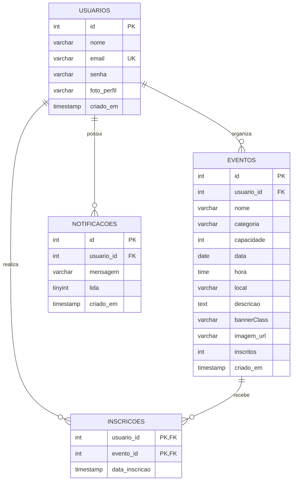

# Banco de Dados (MySQL)

O banco de dados do **Norte Eventos** utiliza **MySQL 8.0** com charset `utf8mb4` (suporte completo a acentuação e emojis) e integridade referencial via chaves estrangeiras com `ON DELETE CASCADE`.

---

## Diagrama Entidade-Relacionamento (DER)



---

## Dicionário de Tabelas

### 1. `usuarios`
Armazena todos os usuários da plataforma (tanto participantes quanto organizadores).

| Coluna | Tipo | Restrições | Descrição |
|---|---|---|---|
| `id` | `INT` | `PK, AUTO_INCREMENT` | Identificador único |
| `nome` | `VARCHAR(100)` | `NOT NULL` | Nome completo |
| `email` | `VARCHAR(100)` | `NOT NULL, UNIQUE` | E-mail de login |
| `senha` | `VARCHAR(255)` | `NOT NULL` | Hash bcrypt da senha |
| `foto_perfil` | `VARCHAR(255)` | `DEFAULT NULL` | Caminho da foto (`/uploads/profiles/...`) |
| `criado_em` | `TIMESTAMP` | `DEFAULT CURRENT_TIMESTAMP` | Data de criação |

### 2. `eventos`
Armazena os eventos cadastrados pelos organizadores.

| Coluna | Tipo | Restrições | Descrição |
|---|---|---|---|
| `id` | `INT` | `PK, AUTO_INCREMENT` | Identificador do evento |
| `usuario_id` | `INT` | `FK -> usuarios(id)` | Organizador dono do evento |
| `nome` | `VARCHAR(150)` | `NOT NULL` | Título do evento |
| `categoria` | `VARCHAR(50)` | `NOT NULL` | Categoria de filtro |
| `capacidade` | `INT` | `NOT NULL` | Limite máximo de vagas |
| `data` | `DATE` | `NOT NULL` | Data de realização |
| `hora` | `TIME` | `NOT NULL` | Horário de início |
| `local` | `VARCHAR(255)` | `NOT NULL` | Endereço / espaço |
| `descricao` | `TEXT` | `DEFAULT NULL` | Descrição detalhada |
| `bannerClass` | `VARCHAR(50)` | `DEFAULT NULL` | Classe de gradiente predefinido |
| `imagem_url` | `VARCHAR(255)` | `DEFAULT NULL` | Caminho da capa enviada (`/uploads/...`) |
| `inscritos` | `INT` | `DEFAULT 0` | Contador atual de participantes |
| `criado_em` | `TIMESTAMP` | `DEFAULT CURRENT_TIMESTAMP` | Data de publicação |

### 3. `inscricoes`
Tabela associativa (`N:N`) entre `usuarios` e `eventos` com chave primária composta `(usuario_id, evento_id)`, impedindo inscrições duplicadas no nível do banco.

> [!NOTE]
> Ao inscrever um participante (`eventoModel.inscrever`), o sistema abre uma transação SQL com `SELECT ... FOR UPDATE` na linha do evento para evitar **race conditions** caso duas pessoas disputem a última vaga ao mesmo tempo.

### 4. `notificacoes`
Registra avisos destinados aos usuários (`lida = 0` para não lida, `lida = 1` para lida).

---

## Inicialização Automática no Docker

O arquivo `docker/init.sql` é montado no container MySQL em `/docker-entrypoint-initdb.d/01-init.sql`. Assim, na primeira vez que o volume `mysql_data` é criado, o MySQL executa esse SQL automaticamente e cria toda a estrutura sem intervenção manual.

Para verificar as tabelas no container em execução:

```bash
docker compose exec -T db mysql -u norte_user -pnorte123 -e "SHOW TABLES;" norte_eventos
```
